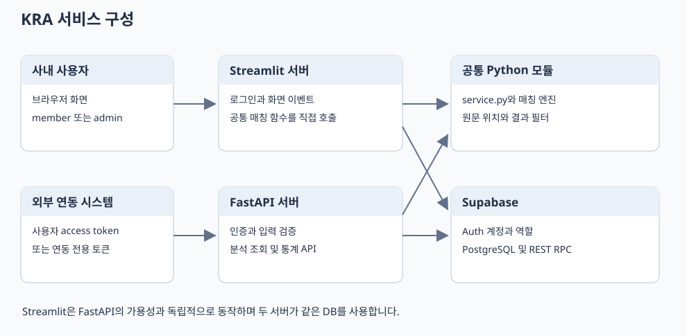

# Keyword Risk Analyzer 시스템 설계서

문서 ID KRA SYS 001 · 버전 1.0 · 기준일 2026년 10월 21일

## 목적과 서비스 범위

등록된 키워드와 리스크 기준을 이용해 입력 문장의 위험 표현을 찾고, 검출 위치와 심의 기준을 보여주는 사내 업무 도구입니다. 관리자는 원장과 분석 설정을 관리하고 사용자는 분석과 공유 통계를 조회합니다. 분석은 규칙 기반 Python 엔진에서 수행하며 외부 생성형 AI를 호출하지 않습니다. 결과는 등록된 원장과 매칭 규칙에 따른 검출 정보이며 자동 심의 승인이나 법적 적합성 판정은 구현 범위에 없습니다.

현재 운영 형태는 Streamlit과 별도 FastAPI가 같은 Supabase 프로젝트를 사용하는 구성입니다. React 화면, 과금, 조직별 독립 저장소, 비동기 대량 작업은 구현하지 않았습니다.

## 사용자와 권한

| 행위 | 미인증 | member | admin | API 연동 토큰 |
|---|---|---|---|---|
| 앱 키워드와 분석 화면 조회 | 불가 | 가능 | 가능 | 화면 로그인 불가 |
| 문장 분석 | 불가 | 가능 | 가능 | API에서 가능 |
| 키워드 CSV와 공유 통계 조회 | 불가 | 가능 | 가능 | 제공된 API 범위에서 가능 |
| 본인 저장 분석 결과 조회 | 불가 | API에서 가능 | API에서 본인 결과 가능 | 동일 연동 주체의 결과 가능 |
| 타인 분석 결과 조회 | 불가 | 불가 | 관리자라도 일반 API로는 불가 | 불가 |
| 원장 등록 편집 삭제 업로드 | 불가 | 불가 | Streamlit에서 가능 | 불가 |
| 공통 매칭 설정과 조회수 초기화 | 불가 | 불가 | Streamlit에서 가능 | 불가 |
| 공개 프로세스 상태 확인 | 가능 | 가능 | 가능 | 가능 |

앱 권한은 Supabase Auth의 `app_metadata.role`에 저장합니다. 허용 값은 `member`와 `admin`입니다. 사용자 편집이 가능한 `user_metadata`는 권한 근거로 사용하지 않습니다. API 연동 토큰은 별도 서버 환경 변수와 비교하고 호출 주체를 문자열 `integration`으로 처리합니다. 한 연동 토큰을 공유하는 시스템은 동일 주체입니다.

## 기능 요구사항과 구현 추적

| ID | 요구사항 | 구현 위치 | 상태 |
|---|---|---|---|
| FR 01 | 사내 계정 로그인과 관리자 구분 | render_cloud_login 및 current_actor | 구현 |
| FR 02 | 정확 유사 부분 문자열 분석 | service.match_text 및 matching_engine | 구현 |
| FR 03 | 카테고리와 리스크 결과 필터 | service.match_text | 구현 |
| FR 04 | 원문 하이라이트와 툴팁 | highlight_text 및 Streamlit 컴포넌트 | 구현 |
| FR 05 | 원장 CSV와 Excel 가져오기 | normalize_upload 및 관리 탭 | 구현 |
| FR 06 | 키워드 등록 편집 삭제 | 관리자 화면 및 kra_save_keywords | 구현 |
| FR 07 | 조사 어미와 무시 기호 설정 | 설정 저장 함수 및 kra_settings | 구현 |
| FR 08 | 분석별 고유 키워드 조회수 집계 | kra_record_analysis | 구현 |
| FR 09 | 최근 7일 Top N 리포트 | 관리 화면과 kra_recent_hits | 구현 |
| FR 10 | 누적 초기화와 주간 초기화 | kra_reset_counts 및 kra_reset_week | 구현 |
| FR 11 | 별도 분석 조회 통계 API | api.py | 구현 |
| FR 12 | 여러 조직의 데이터 격리 | 조직 식별자와 정책 없음 | 미구현 |
| FR 13 | 키워드 편집 이력과 승인 절차 | 감사 테이블과 승인 상태 없음 | 미구현 |

## 전체 아키텍처



```text
사내 사용자 브라우저 → Streamlit 서버 → 공통 매칭 함수 → Python 엔진
                             └→ SupabaseRepository → Supabase REST RPC와 Auth
외부 연동 시스템 → FastAPI 서버 → analyze → 공통 매칭 함수 → Python 엔진
                             └→ SupabaseRepository → 같은 Supabase 프로젝트
```

Streamlit은 FastAPI를 HTTP로 호출하지 않습니다. API 프로세스 중단이 곧바로 Streamlit 분석 중단으로 이어지지는 않습니다. 두 프로세스 모두 Supabase와 Python 실행 환경이 필요합니다.

공통화된 범위는 매칭 엔진, 결과 필터와 저장소 모듈입니다. Streamlit의 버튼 처리와 API의 `analyze`가 완전히 같은 최상위 함수로 통합된 것은 아닙니다. 옵션 기본값과 결과 없는 분석의 저장 방식에도 차이가 있습니다.

## 모듈 책임

| 파일 | 책임 | 주요 외부 의존 |
|---|---|---|
| keyword_app2_fixed271.py | 화면, 로그인 세션, 편집, 하이라이트, 파일 입출력 | Streamlit, pandas |
| api.py | 요청 검증, 인증, 라우팅, 예외 응답 | FastAPI, Pydantic |
| service.py | API 분석 흐름과 공통 후처리 필터 | 매칭 엔진, 저장소 |
| matching_engine.py | 정규화, 후보 생성, 위치와 겹침 처리 | pandas, Python re |
| repository.py | 서버 전용 REST RPC 및 Auth 호출 | requests |
| app_config.py | 프로세스 환경, 로컬 설정과 저장 모드 | os, pathlib |
| supabase/schema.sql | 테이블, 제약, 인덱스, 함수와 접근권한 | PostgreSQL |
| scripts/import_to_supabase.py | 원장과 로그의 초기 이관 | pandas, 저장소 |

## 분석과 집계 처리

1. 로그인 정보와 역할을 확인합니다.
2. 키워드 전체, 컬럼 순서와 revision을 단일 스냅샷으로 읽습니다.
3. 카테고리와 리스크 필터로 분석 대상 키워드를 먼저 선택합니다.
4. 매칭 옵션과 공통 설정을 구성하고 원문 위치를 보존하며 완전 또는 일부 일치로 분석합니다. 다른 코드의 겹친 검출은 유지하고 하이라이트에서만 표시 구간을 합칩니다.
5. API의 `record=true` 또는 Streamlit의 검출 성공 시 저장 함수를 호출합니다.
6. 저장 함수는 revision과 요청 중복을 검사하고 분석 기록, 고유 키워드별 이벤트와 누적 조회수를 하나의 트랜잭션에서 갱신합니다.
7. 화면 또는 JSON 결과를 반환합니다.

## 정합성과 동시성

관리자 저장과 분석 기록은 `kra_state`의 단일 행을 잠가 짧은 쓰기 구간을 직렬화합니다. 매칭 연산 자체는 DB 잠금 밖에서 실행합니다. 원장이나 공통 설정이 분석 중 바뀌면 저장 시 revision 충돌을 반환합니다. 원장 편집 시 기존 키워드의 조회수와 마지막 출력일자를 보존합니다.

`revision`은 원장과 공통 설정 변경 버전입니다. 조회수 증가나 초기화 때 증가하는 데이터 전체 버전은 아닙니다. 분석별 별도 엔진 버전이나 공통 설정 전체 스냅샷은 현재 저장하지 않습니다.

## 보안 경계

브라우저에는 서버 비밀 키를 전달하지 않습니다. `kra_` 테이블은 RLS를 활성화하고 일반 클라이언트 역할의 직접 권한을 회수했습니다. 서버 키는 RLS를 우회하므로 앱의 역할 검사와 분석 소유자 검사가 실제 사용자 접근 경계입니다. 키를 가진 서버 코드를 신뢰하는 구조이며 사용자별 RLS가 적용된 브라우저 직접 접근 구조가 아닙니다.

원문 전체를 DB에 저장하지 않지만 입력 지문, 검출 단어와 기준은 저장됩니다. 원문과 세션 토큰은 앱 메모리에 존재할 수 있습니다. 로컬 `.env`와 Streamlit Secrets는 배포 산출물과 문서에 포함하지 않습니다.

## 현재 제약과 개선 제안

| 항목 | 현재 상태 | 개선 제안 |
|---|---|---|
| 성능 목표 | 처리량과 응답 시간 SLA 미정 | 실제 문장 길이와 동시 사용자로 목표 설정 |
| 매칭 캐시 | 전체 원장 스냅샷을 매 분석에서 조회 | revision 기반 캐시를 측정 후 도입 |
| 이력 재현 | 결과와 revision만 저장 | 엔진 버전과 설정 스냅샷 추가 |
| 연동 주체 | 정적 토큰 하나에 integration 주체 하나 | 연동처가 늘면 토큰별 식별과 폐기 추가 |
| 감사와 복구 | 변경 감사 로그와 자동 복구 절차 없음 | 원장 변경 이력과 복원 훈련 추가 |
| 입력 제한 | API 스키마 검증, UI 최대 글자수 설정 | Streamlit 서버 측 동일 검증 추가 |
| 호스팅 | Render 설정 파일 존재, 공개 배포 미확인 | 배포 후 로그인과 상태 확인 검수 |

## 기준 소스

`api.py`, `service.py`, `repository.py`, `matching_engine.py`, `keyword_app2_fixed271.py`, `app_config.py`, `supabase/schema.sql`, `render.yaml`을 기준으로 작성했습니다. 관련 설계의 상세 규약은 같은 폴더의 API, 화면, DB와 운영 문서를 참조합니다.
