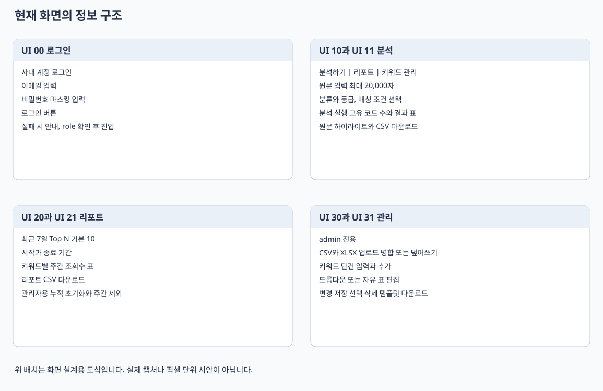

# Keyword Risk Analyzer 화면 설계서

문서 ID KRA UI 001 · 버전 1.2 · 기준일 2026년 10월 22일

## 화면 구성과 적용 범위

현재 Streamlit 화면을 업무 단위로 나눈 설계입니다. 화면 ID는 인수인계용 식별자이며 실제 URL 경로가 아닙니다. 일반 사용자에게는 분석하기·리포트 탭을 표시하고, 관리자에게는 키워드 관리와 Supabase 사용자 관리 탭도 표시합니다. 배치도는 현재 위젯의 정보 구조를 정리한 것으로 정확한 픽셀 크기나 브라우저 캡처를 의미하지 않습니다.



| 화면 ID | 화면과 영역 | 진입 조건 | 주요 연결 |
|---|---|---|---|
| UI 00 | 사내 계정 로그인 | Supabase 모드의 미인증 사용자 | Auth 로그인 |
| UI 01 | 공통 사이드바와 탭 | 유효한 member 또는 admin | 최신 원장 불러오기, 로그아웃 |
| UI 10 | 분석 입력과 실행 옵션 | 로그인 완료 | 공통 매칭 함수 |
| UI 11 | 분석 결과와 하이라이트 | 검출 성공 | 원장 정보, 결과 CSV |
| UI 12 | 키워드 목록과 필터 | 로그인 완료 | 원장 조회와 CSV |
| UI 20 | 주간 리포트 | 로그인 완료 | 최근 7일 이벤트 |
| UI 21 | 조회수 초기화 | admin | 누적 초기화, 주간 제외 |
| UI 30 | 업로드와 단건 등록 | admin | 원장 저장 |
| UI 31 | 키워드 표 편집과 삭제 | admin | 원장 저장 |
| UI 32 | 공통 선택값과 매칭 설정 | admin 저장 권한 | 공통 설정 저장 |

## UI 00 사내 계정 로그인

화면에는 이메일, 비밀번호 입력과 로그인 버튼을 배치합니다. 비밀번호는 password 입력 형식으로 마스킹합니다. 입력 후 폼 제출 시 Supabase Auth의 password 로그인 경로를 호출합니다. 앱에는 계정 가입이나 비밀번호 찾기 화면이 없습니다.

| 요소 | 형식 | 이벤트와 처리 |
|---|---|---|
| 이메일 | 텍스트 입력 | Supabase Auth로 전달 |
| 비밀번호 | 마스킹 입력 | 서버 메모리에서 인증 요청 |
| 로그인 | 폼 제출 버튼 | 성공 시 세션 저장 후 앱 재실행 |
| 오류 안내 | 오류 메시지 | 계정과 연결 설정을 확인하도록 표시 |

로그인 전에는 원장과 보고서 데이터를 조회하지 않습니다. 로그인 후에도 role이 member 또는 admin이 아니면 앱 접근을 중단합니다. 세션 만료가 60초 이내이면 refresh token으로 갱신하고, 앱 재실행마다 사용자와 역할을 Auth 서버에서 확인합니다.

## UI 01 공통 영역

사이드바에는 로그인 이메일, 로그아웃, 공유 저장소 안내와 최신 데이터 불러오기를 둡니다. 최신 데이터 불러오기는 원장 DataFrame, revision과 컬럼 순서를 갱신하고 리포트 캐시를 지웁니다. 로그아웃은 서버 세션 종료를 요청하고 현재 Streamlit 세션을 비웁니다.

CSV 개발 모드에서는 공용 관리자 비밀번호와 관리자 전용 경로 변경 기능을 사용합니다. Supabase 모드에서는 임의 로컬 파일 경로를 운영 저장소로 선택하지 않습니다.

## UI 10 분석 입력과 옵션

```text
[분석하기] [리포트 주간 Top N] (관리자: [키워드 관리] [사용자 관리])
① 텍스트 입력
[분석할 원문                                           ]
② 분석 실행
[카테고리 복수 선택] [리스크 등급 복수 선택] [키워드 매칭 방식]
[키워드 매칭 옵션 펼치기: 괄호 / 공백 / 대소문자 / 기호]
[모드별 추가 옵션]
[적용 중인 규칙 요약 펼치기]
[텍스트 분석하기]
```

| 입력 | 화면 초기값과 범위 | 처리 |
|---|---|---|
| 분석할 텍스트 | 예시 문장, 위젯 최대 20,000자 | 원문을 매칭 함수에 전달 |
| 상품카테고리 | 전체 의미의 빈 선택 | 매칭 전 원장 필터 |
| 리스크 등급 | 전체 의미의 빈 선택 | 매칭 전 원장 필터 |
| 키워드 매칭 방식 | 키워드 완전 일치 | 완전 일치(exact), 일부 일치(partial, 2글자), 글자 수 매칭 - 탐색용(partial, 설정 길이) |
| 등록 키워드의 괄호 설명 제외 | 체크됨 | strip_bracket_notes=true |
| 띄어쓰기·줄바꿈 차이 허용 | 체크됨 | normalize_whitespace=true |
| 영문 대소문자 무시 | 체크됨 | ignore_case=true |
| 설정된 기호를 공백으로 처리 | 체크됨 | normalize_symbols=true |
| 최소 일치 글자수 | 2, 2부터 20 | 글자 수 매칭에서 표시, 모드 전환 후 값 유지. 일부 일치는 2글자 고정 |

API 기본값은 mode=similar, exact_relaxed=false이고 부분 문자열 상한은 30입니다. 같은 결과를 비교할 때는 화면에서 선택한 옵션을 API에 모두 명시합니다. 글자수는 위젯 제한이며 현재 Streamlit 서버 코드에서 API와 같은 별도 Pydantic 검증을 수행하지 않습니다.

정확 모드에서 괄호 설명 제외를 끄면 괄호 포함 등록명을 찾는다는 안내를 표시합니다. 예를 들어 등록명 `안티에이징(anti-aging)`은 `안티에이징으로`에서 검출되지 않으며, 괄호 옵션만 켜면 괄호 밖 표현도 찾습니다. 공백·대소문자·기호는 별도로 선택합니다. 어떤 옵션도 조사·어미 허용 여부를 전환하는 설정은 아닙니다.

네 옵션은 기본적으로 접힌 키워드 매칭 옵션 익스팬더 안에 배치하며 예시 도움말을 제공합니다. 선택은 모드를 바꿔도 유지되며 옵션이나 검사 방식을 바꾸면 이전 분석 결과를 숨깁니다. 다시 분석 버튼을 눌러야 새 조건으로 실행하고 집계합니다. 기존 세션의 묶음 옵션은 괄호·공백·기호 설정의 초기값으로 옮기며 영문 대소문자 무시는 켜짐으로 유지합니다. 적용 중인 규칙 요약의 모든 문구는 주변 설명과 같은 네이티브 caption 글꼴과 크기를 사용합니다.

키워드 매칭 방식은 세 가지입니다. 완전 일치는 등록 표현 전체가 문장 어디든 포함되면 찾습니다. 일부 일치는 앞·중간·뒷부분의 연속 2글자 이상을 찾습니다. 글자 수 매칭은 같은 원리로 최소 글자수를 조절하며 2이면 일부 일치와 결과가 같습니다. 각 라디오 항목 오른쪽의 물음표에 해당 방식의 설명과 O/X 예시를 제공합니다. 그룹 제목 옆에는 통합 도움말을 표시하지 않습니다. 문장은 마침표 뒤에 빈 줄을 두고 예시)는 별도 문단으로 표시합니다. 안티에이징 등록 시 입력 에이징은 완전 일치 X, 일부 일치 O, 글자 수 매칭 최소 4글자 X입니다.

네 개별 매칭 옵션과 최소 글자수 도움말도 같은 문단·O/X 형식을 사용합니다. 두 고급 역매칭 옵션은 새 일부 일치와 역할이 겹쳐 화면에서 제거하며 API 호환용으로만 유지합니다. 화면 선택값 similar는 일부 일치를 뜻하지만 실행 설정은 mode=partial, partial_min_len=2로 변환합니다. API의 기존 similar 검출 규칙을 사용하는 것이 아닙니다. 요약·설정 안내 문장도 문장별로 문단을 나눕니다.

적용 중인 규칙 요약에는 현재 방식과 네 옵션의 상태, 부분 검색의 실제 최소 글자수를 표시합니다. 현재 세 방식에서는 조사·어미 목록을 사용하지 않습니다. 공통 기호 목록은 기호 처리 옵션이 켜졌을 때 표시합니다. 목록 편집은 관리자 키워드 관리 탭에서 수행합니다. 일부 일치는 등록명의 일부를 찾으므로 괄호 옵션을 꺼도 괄호 밖 일부만 검출될 수 있습니다.

분석 버튼을 누르면 최신 원장을 읽고 클라우드 공통 설정을 다시 읽습니다. 검출된 고유 코드가 있으면 새 UUID로 분석을 기록하고 조회수를 증가시킵니다. 검출이 없으면 안내만 표시하며 Streamlit에서는 분석 실행 행을 저장하지 않습니다. 같은 버튼을 다시 누르면 새로운 분석으로 집계합니다.

## UI 11 결과와 하이라이트

별도 보조 분석 익스팬더에서 Kiwi 형태소 분석(기본 켬)과 임베딩 의미 검색(기본 끔)을 선택하고 보조 분석 실행 버튼으로만 호출합니다. 기존 결과 표 열·CSV·조회수·하이라이트는 변경하지 않습니다. 결과는 방식별 후보 목록으로 표시하며 임베딩 실패는 경고로 표시합니다. 원문·필터·보조 옵션을 바꾸면 이전 보조 결과를 숨깁니다. 의미 검색은 위험 확률이 아닌 관련 후보이며 기본 최대 10개를 제안합니다.

검출 성공 시 고유 키워드 수, 원장 정보 표, 위치 표시 선택, 결과 CSV, 원문 하이라이트와 툴팁을 제공합니다. 표에는 kwd_no와 원장 전체 컬럼을 조인해 대체어와 증빙 기준도 보여줄 수 있습니다. 원장의 현재 정보가 조인되므로 과거 결과 전용 불변 스냅샷 뷰는 아닙니다.

표와 CSV는 기존 열 구성을 유지하며 실제 일치 문구 열을 추가하지 않습니다. 입력 에이징 관리에서 일부가 일치하면 등록 키워드 안티에이징을 결과로 표시하며 조각을 새 DB 키워드로 생성하지 않습니다. 원문 일치 범위는 하이라이트와 기존 start/end로 확인합니다.

위치별 분석 결과와 고유 키워드 표시 목록은 분리합니다. 동일 키워드가 두 번 검출되면 위치별 결과에는 두 행이 있지만 화면 발견 건수와 누적 조회 증가 단위는 고유 kwd_no입니다. 서로 겹치는 다른 키워드의 실제 구간은 모두 보존합니다. 같은 키워드의 포함된 짧은 후보만 제거하고 하이라이트에서 겹치는 범위를 합쳐 모든 해당 코드를 표시합니다. 예를 들어 피부와 피부보습이 모두 등록되어 있으면 표에는 두 코드가 남고 원문 구간을 한 번 칠해 두 코드를 함께 표시합니다.

| 상태 | 화면 처리 |
|---|---|
| 원장 없음 | 키워드 추가 안내 |
| 매칭 없음 | 이전 표시 결과를 비우고 미검출 안내 |
| 검출 성공 | 결과와 CSV 및 하이라이트 세션 저장 |
| 분석 중 원장 revision 변경 | 저장 오류 표시, 최신 원장으로 재분석 필요 |
| 기타 예외 | 현재 코드는 상세 traceback을 화면에 표시할 수 있음 |

상세 traceback 노출을 운영자 로그와 사용자용 간단한 오류로 분리하는 것은 개선 제안입니다. 하이라이트는 기존 HTML과 JavaScript 컴포넌트를 사용하며 네이티브 Streamlit 위젯만으로 구성된 부분은 아닙니다.

## UI 12 원장 목록과 필터

분석 탭 하단에서 키워드 검색, 카테고리, 리스크 등급, 증빙자료유형을 지정합니다. 검색은 키워드명, 대체키워드, kwd_no를 대상으로 하고 필터 적용 버튼으로 반영합니다. 필터 초기화로 조건을 지웁니다. 분석 결과에 적용하는 카테고리 필터와 원장 목록 필터는 별도 상태입니다.

관리자는 목록 편집 모드를 켜고 현재 필터된 행의 변경사항을 저장할 수 있습니다. 일반 사용자는 읽기 전용 표를 봅니다. 클라우드에서는 kwd_no, 누적 조회수와 마지막 출력일자 컬럼을 편집할 수 없습니다. 키워드 CSV 다운로드는 현재 원장 전체를 대상으로 합니다.

## UI 20 주간 리포트

```text
[최근 7일 Top N]
[Top N 10] [한국 시간 기준 시작과 종료]
[키워드별 최근7일 조회수와 원장 기준 표]
[리포트 CSV 다운로드]
[조회 수 초기화 영역]
```

Top N은 1부터 100까지이며 기본 10입니다. 최근 7일의 visible 이벤트를 kwd_no별로 집계하고 원장 정보와 조인합니다. 대체키워드 다음에 최근7일_조회수 컬럼을 배치합니다. 리포트 CSV는 화면에서 계산한 보고서 데이터를 내려받습니다.

이벤트가 없으면 분석 실행 안내를 표시합니다. 캐시 유효 시간은 30초이며 다른 사용자나 API에서 기록한 이벤트는 캐시가 만료되거나 새로 불러올 때 반영될 수 있습니다. 화면 안에서 분석이나 주간 초기화를 실행하면 캐시를 무효화합니다.

현재 화면은 건수 정렬 후 head를 취하고 선택된 결과를 코드로 다시 정렬합니다. API DB 집계는 건수와 코드를 함께 정렬한 뒤 limit합니다. Top N 경계에서 동점이 많으면 선택되는 코드가 달라질 수 있으며 정렬 통일은 개선 제안입니다.

## UI 21 조회수 초기화

| 동작 | 실행 조건 | DB 영향 | 유지되는 것 |
|---|---|---|---|
| 전체 초기화 실행 | admin 및 확인 체크 | hit_count=0, last_hit 빈 값 | 원장 정보, 분석 기록, 이벤트 |
| 최근 7일 초기화 실행 | admin 및 확인 체크 | 기간 이벤트 visible=false | 누적 조회수, 분석 기록, 원래 이벤트 |

비관리자에게는 초기화 영역의 제목·체크박스·버튼 전체를 표시하지 않습니다. 실행 시 서버에서도 관리자 검사를 수행합니다. 전체 초기화는 주간 이벤트를 지우지 않으므로 주간 리포트가 계속 나올 수 있습니다. 주간 초기화는 실제 삭제가 아니라 리포트 제외입니다. 일부 기존 화면 문구가 로그 삭제라고 표현하더라도 클라우드 실제 동작은 visible 변경입니다.

전체 초기화 함수는 갱신 대상 WHERE 조건을 사용하므로 Supabase safeupdate를 유지한 채 실행합니다. 아무 행도 바꿀 필요가 없어도 성공합니다. UI는 확인 체크만 사용하고 2차 승인이나 복원 버튼은 없습니다.

## UI 30 가져오기와 등록

지원 파일은 `.csv`와 `.xlsx`입니다. CSV는 UTF 8 BOM, UTF 8, CP949, EUC KR, Latin 1 순으로 읽기를 시도합니다. XLSX는 pandas로 읽고 실패하면 단순 첫 시트 파서로 대체합니다. 대체 파서는 수식 평가, 병합 셀과 날짜 서식을 완전하게 지원하지 않습니다.

업로드 모드는 기존 유지와 새로 추가 또는 완전 덮어쓰기입니다. 파일이 선택되고 읽기와 정규화가 성공하면 저장을 시도하며, 별도 업로드 승인 단계는 없습니다. 완전 덮어쓰기는 누락된 원장 행을 삭제할 수 있으므로 운영 절차상 백업 후 사용합니다.

| 등록 입력 | 필수 또는 동작 |
|---|---|
| 키워드명 | 필수, 앞뒤 공백 제거 |
| 상품카테고리 | 기존 값 또는 직접 입력 |
| 리스크 등급 | 원장에서 얻은 선택값 |
| 세부 심의기준 | 기존 값 또는 직접 입력 |
| 증빙자료유형 | 기존 값 또는 직접 입력 |
| 대체키워드 | 기존 값 또는 직접 입력 |
| 직접 지정 키워드NO | 선택, 영문 접두사와 숫자 형식 |

번호를 생략하면 세션이 가진 원장 번호를 보고 다음 코드를 계산합니다. DB sequence로 업무용 kwd_no를 발급하는 구조는 아닙니다. 동시 등록은 revision과 PK 검사로 충돌을 거절하므로 최신 데이터를 읽고 재시도해야 할 수 있습니다.

## UI 31 표 편집과 삭제

드롭다운 제한 입력과 자유 입력 모드를 제공합니다. 클라우드에서는 행 수를 고정하고 코드와 집계 컬럼을 잠급니다. 신규 행은 단건 등록이나 업로드를 이용합니다. 변경사항 저장 버튼을 눌러야 DB에 반영합니다.

삭제는 kwd_no 복수 선택 후 선택 삭제로 실행합니다. 원장 행을 물리 삭제하지만 과거 이벤트는 코드 참조를 유지합니다. 별도 원장 휴지통, soft delete와 삭제 복구 UI는 없습니다. 오래된 세션으로 저장하면 최신 데이터로 갱신하고 충돌 메시지를 표시합니다.

## UI 32 공통 설정

관리자 키워드 관리 탭 안의 공통 분석 규칙 영역에서 키워드 뒤에 붙는 말 허용 목록과 공백으로 처리할 기호 목록을 관리합니다. 각 폼을 제출해야 저장되며 설정 저장은 관리자만 허용하고 revision을 증가시킵니다. 일반 사용자에게는 이 편집 위젯을 생성하지 않습니다. 드롭다운 편집은 기존 관리자 화면을 유지합니다.

허용 목록은 기존 API용 조사·어미 허용 목록으로 표시합니다. 기존 similar API의 변형 규칙 검사에서만 참조하며 현재 화면에는 적용하지 않습니다. `으로`, `로`, `에는`은 이미 기본 목록에 있습니다. 기존 API는 별도 합성어 규칙도 적용하므로 목록에 없는 뒷말이 붙어도 검출될 수 있습니다.

분석하기 탭은 키워드 매칭 방식, 키워드 매칭 옵션과 적용 중인 규칙 요약을 제공합니다. 분석 실행 시 공통 규칙을 다시 읽고 요약도 사용한 스냅샷으로 갱신합니다. 기호는 한 줄에 하나씩 입력하며 쉼표도 저장할 수 있고, 여러 글자를 입력하면 저장하지 않습니다. 빈 기호 목록의 기본값 복원 동작은 유지합니다.

기존 분석 경로에서 자동 수집되지 않던 접미사 후보 안내는 제거했습니다. 후보 제안 기능을 구현하거나 합성어 검출 정책을 변경한 것은 아닙니다.

## UI 40 사용자 역할 관리

Supabase 관리자에게만 사용자 관리 탭을 표시합니다. 페이지당 최대 50개 계정을 직접 불러온 뒤 계정과 member/admin 역할을 선택하고 변경 확인을 체크해 저장합니다. 자신의 관리자 권한 해제는 차단합니다. 목록 조회와 저장마다 Auth 서버에서 관리자 역할을 재확인하고 대상 역할이 목록과 다르면 새로고침을 요청합니다. 새 계정 생성은 Supabase Dashboard에서 수행합니다.

## 화면 상태와 검수 기준

| 상태 그룹 | 주요 Session State | 수명 |
|---|---|---|
| 인증 | auth_session, cloud_user, is_admin | 로그인 세션 |
| 원장 | kw_df, cloud_revision, db_cols_order | 최신 불러오기와 분석 시 갱신 |
| 분석 선택 | match_mode, strip_bracket_notes, normalize_whitespace, ignore_case, normalize_symbols, pre_cats, pre_risks | 세션 |
| 분석 결과 | analysis_df_full, analysis_text, analysis_highlight_html | 다음 분석 또는 로그아웃까지 |
| 목록 필터 | 입력값과 applied 필터값 | 필터 적용과 초기화 |

브라우저 새로고침이나 연결 종료 시 세션 상태 보존을 영구 저장으로 보장하지 않습니다. 검수에서는 미인증 접근 차단, 역할별 저장 차단, 화면과 API의 명시적 옵션 일치, 빈 결과 안내, 초기화 후 주간 통계 유지 여부를 확인합니다.

## 기준 소스

`keyword_app2_fixed271.py`의 로그인, st.tabs, 분석 버튼, 결과 표시, 목록 필터, 관리자 탭과 리포트 영역을 기준으로 작성했습니다. 근거 함수는 render_cloud_login, init_state, load_db, save_db, highlight_text, merge_or_overwrite와 설정 저장 함수입니다.
