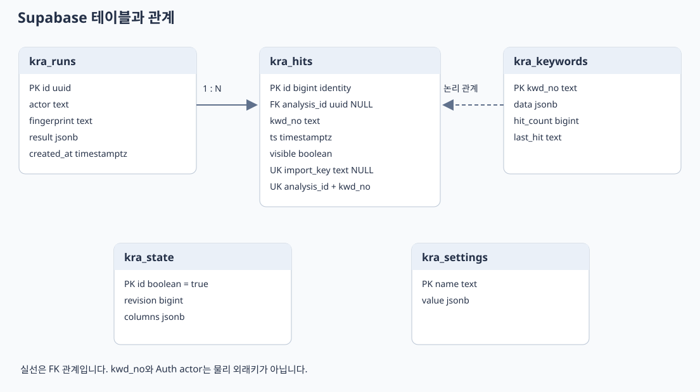
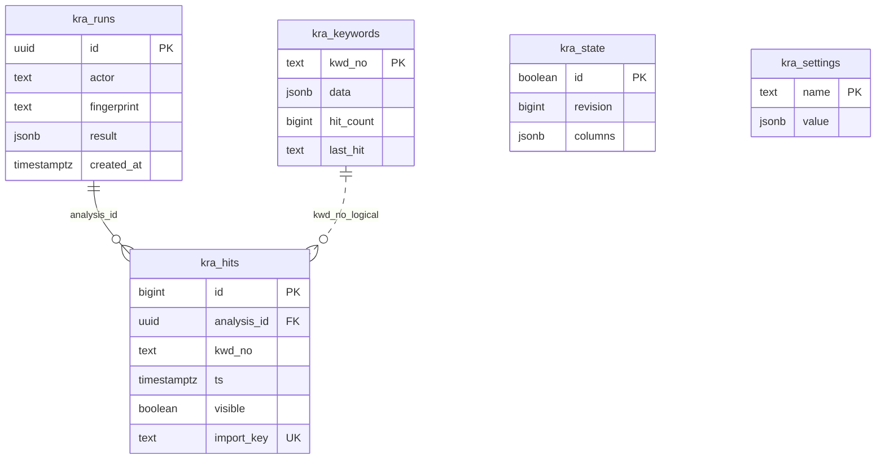

# Keyword Risk Analyzer Supabase 설계서

문서 ID KRA DB 001 · 버전 1.0 · 기준일 2026년 10월 21일

## 프로젝트와 데이터 영역

앱은 Supabase의 PostgreSQL, Data API와 Auth를 사용합니다. Realtime, Storage 버킷, Edge Functions와 Cron은 현재 앱에서 사용하지 않습니다. 프로젝트 참조는 `qmhdwfqcihpfjfvcjcwa`이고 API 주소는 `https://qmhdwfqcihpfjfvcjcwa.supabase.co`입니다.

업무 데이터는 public 스키마의 `kra_` 테이블 5개에 저장합니다. 기존 `public.keywords`와 프로젝트 내 다른 앱 데이터는 이 앱의 신규 저장소에서 제외했습니다. JSONB 원장에는 현재 컬럼을 그대로 보존하고 정합성에 중요한 코드와 집계는 별도 물리 컬럼으로 관리합니다.

## ERD와 관계





점선 코드 관계는 DB 외래키가 아닌 논리 관계입니다. Auth 사용자의 UUID를 actor에 넣지만 actor는 text이며 auth.users에 대한 FK가 아닙니다. 따라서 연동 주체 문자열을 함께 저장할 수 있습니다.

## 테이블 명세

### kra_state 원장 버전과 컬럼 순서

| 컬럼 | DB 형식 | NULL | 기본값 | 제약과 의미 |
|---|---|---|---|---|
| id | boolean | 불가 | true | PK 및 CHECK(id), true 단일 행 |
| revision | bigint | 불가 | 0 | 원장과 공통 설정 변경 버전 |
| columns | jsonb | 불가 | [] | 원장 출력 컬럼 순서 |

원장 저장, 설정 변경, 분석 기록과 초기화에서 이 행을 FOR UPDATE로 잠급니다. 원장과 설정을 저장할 때만 revision을 증가시킵니다. columns가 실제 JSON 배열인지에 대한 테이블 CHECK는 없으며 저장 RPC가 입력 형식을 확인합니다.

### kra_keywords 키워드 원장

| 컬럼 | DB 형식 | NULL | 기본값 | 제약과 의미 |
|---|---|---|---|---|
| kwd_no | text | 불가 | 없음 | PK, btrim 값이 비어 있지 않음 |
| data | jsonb | 불가 | 없음 | JSON object CHECK, 업무 속성 |
| hit_count | bigint | 불가 | 0 | 0 이상 CHECK |
| last_hit | text | 불가 | 빈 문자열 | 한국 시간 표시 문자열 |

last_hit은 현재 timestamptz가 아닌 text입니다. 공백으로 초기화하는 기존 CSV 표현을 유지합니다. 조회 스냅샷은 물리 kwd_no와 hit_count 및 last_hit을 JSONB 업무 속성에 합쳐 원장 형태로 반환합니다. 기존 행을 저장할 때 data만 갱신해 조회수와 마지막 출력일자의 오래된 덮어쓰기를 방지합니다.

### kra_settings 공통 설정

| 컬럼 | DB 형식 | NULL | 기본값 | 의미 |
|---|---|---|---|---|
| name | text | 불가 | 없음 | PK, 설정 이름 |
| value | jsonb | 불가 | 없음 | 설정 데이터 |

현재 키는 dropdown_config, ko_suffix_whitelist, ignored_special_symbols입니다. 설정별 JSON Schema나 허용 키 CHECK는 DB에 정의하지 않았습니다.

```json
{"extra_suffixes":["예시어미"]}
```

위 구조는 ko_suffix_whitelist의 예시입니다. 무시 기호는 `{"symbols":["/","&",",","*"]}` 형식입니다. dropdown_config는 opt_categories, opt_risks, opt_details, opt_evidences, opt_alt_terms 배열을 사용합니다.

### kra_runs 분석 실행

| 컬럼 | DB 형식 | NULL | 기본값 | 의미 |
|---|---|---|---|---|
| id | uuid | 불가 | 없음 | PK, 호출자가 전달한 분석 ID |
| actor | text | 불가 | 없음 | 사용자 UUID 문자열 또는 integration |
| fingerprint | text | 불가 | 없음 | 입력 지문 SHA 256의 16진 문자열 |
| result | jsonb | 불가 | 없음 | 검출 결과, 고유 코드와 revision |
| created_at | timestamptz | 불가 | now() | 실행 기록 생성 시각 |

DB는 fingerprint 길이와 SHA 256 형식을 별도 CHECK하지 않습니다. 원문 전체와 엔진 버전은 별도 컬럼으로 저장하지 않습니다. 결과 JSON에는 검출된 표현과 기준이 포함되므로 민감 정보가 전혀 없는 데이터로 취급하지 않습니다.

### kra_hits 조회 이벤트

| 컬럼 | DB 형식 | NULL | 기본값 | 제약과 의미 |
|---|---|---|---|---|
| id | bigint identity | 불가 | 자동 생성 | PK |
| analysis_id | uuid | 가능 | 없음 | FK kra_runs.id, 기본 삭제 동작 NO ACTION |
| kwd_no | text | 불가 | 없음 | 원장 코드, 물리 FK 없음 |
| ts | timestamptz | 불가 | now() | 이벤트 시각 |
| visible | boolean | 불가 | true | 주간 리포트 집계 여부 |
| import_key | text | 가능 | 없음 | UNIQUE, 기존 로그 이관 중복 방지 |

`UNIQUE(analysis_id,kwd_no)`로 같은 분석의 같은 키워드를 한 번만 기록합니다. analysis_id가 NULL인 기존 이관 로그는 PostgreSQL의 NULL 구분 규칙에 따라 같은 kwd_no가 여러 번 존재할 수 있습니다. 기존 로그를 추측한 분석 ID로 묶지 않습니다.

## 원장 데이터 사전

| 순서 | 원장 컬럼 | 저장 위치와 용도 |
|---|---|---|
| 1 | kwd_no | 물리 PK, 스냅샷에서 최종 값 주입 |
| 2 | 키워드명 | data, 분석 후보 원문 |
| 3 | 상품카테고리 | data, 분류와 필터 |
| 4 | 리스크 등급 | data, 표시와 필터 |
| 5 | 대체키워드 | data, 대체 표현 안내 |
| 6 | 리스크 등급별 세부 심의기준 | data, 검출 상세 |
| 7 | 증빙자료유형 | data, 기준 자료 안내 |
| 8 | 키워드 조회 수(누적카운트) | hit_count를 문자열로 변환해 스냅샷 반환 |
| 9 | 마지막 출력일자 | last_hit을 스냅샷 반환 |
| 10 | 키워드등록일자 | data, 기존 원장 컬럼 |
| 11 | 키워드등록인 | data, 기존 원장 컬럼 |
| 12 | 비고 | data, 추가 메모 |
| 13 | 키워드 등록일자 | data, 신규 등록 화면에서 사용하는 컬럼 |

등록일자는 띄어쓰기가 다른 두 컬럼이 현재 공존합니다. 서로 같은 값으로 병합했다고 가정하지 않습니다. 컬럼 통합과 타입 정리는 별도 데이터 정제 작업입니다. 스냅샷의 값은 원장 호환성을 위해 문자열로 읽습니다. DB의 hit_count는 숫자입니다.

## 인덱스와 제약

| 인덱스 또는 제약 | 대상 | 목적 |
|---|---|---|
| 각 테이블 PK | id, kwd_no 또는 name | 중복 식별 방지 |
| kra_hits_ts_idx | kra_hits(ts) WHERE visible | 기간별 표시 이벤트 조회 |
| kra_hits_kwd_idx | kra_hits(kwd_no) | 코드별 이벤트 접근 |
| kra_runs_actor_idx | kra_runs(actor) | 호출 주체별 접근 지원 |
| UNIQUE analysis_id와 kwd_no | kra_hits | 분석 단위 중복 집계 차단 |
| UNIQUE import_key | kra_hits | 같은 이관 로그 중복 차단 |

키워드 JSONB의 이름 검색에 대한 GIN 또는 전문 검색 인덱스는 없습니다. 현재 키워드 API는 전체 스냅샷을 가져와 Python에서 검색합니다.

## RPC 목록

모든 함수는 public 스키마에 있고 SECURITY INVOKER이며 search_path는 빈 문자열입니다. 함수 실행은 service_role에만 부여하고 PUBLIC, anon과 authenticated에는 회수합니다.

| 함수 | 입력 | 반환 | 주요 처리 |
|---|---|---|---|
| kra_snapshot | 없음 | jsonb | revision, columns, rows를 한 SQL 스냅샷으로 반환 |
| kra_save_keywords | rows jsonb, columns jsonb, revision bigint | bigint | 원장 교체와 버전 검사, 새 revision |
| kra_get_setting | name text | jsonb 또는 null | 공통 설정 조회 |
| kra_set_setting | name text, value jsonb | void | 설정 upsert와 revision 증가 |
| kra_get_analysis | id uuid, actor text, fingerprint text 기본 null | jsonb 또는 null | 소유자와 입력 지문 검사 |
| kra_record_analysis | id uuid, fingerprint text, actor text, revision bigint, result jsonb | jsonb | 중복 검사와 분석 집계 원자 저장 |
| kra_recent_hits | days integer 기본 7 | jsonb | 기간 내 visible 로그 배열 |
| kra_top_keywords | days integer 기본 7, limit integer 기본 10 | jsonb | 코드별 이벤트 수와 현재 이름 |
| kra_reset_counts | 없음 | void | 누적 수와 마지막 출력일자 초기화 |
| kra_reset_week | 없음 | bigint | 최근 7일 visible=false, 변경 건수 |

실제 RPC 인수명은 `p_` 접두사를 사용합니다. 예를 들어 저장 RPC는 p_rows, p_columns, p_revision을 받습니다. 정확한 시그니처는 배포 SQL에 있습니다. API의 revision은 별도 설정 버전 컬럼이 아니라 같은 상태 행의 revision입니다.

## 원장 저장 트랜잭션

1. 상태 행을 잠그고 전달한 revision과 현재 값을 비교합니다.
2. rows와 columns가 배열인지, kwd_no가 비어 있거나 중복되지 않는지 검사합니다.
3. 새 목록에 없는 기존 키워드를 삭제합니다.
4. 새 키워드를 삽입하고 기존 코드는 data만 갱신합니다.
5. 컬럼 순서를 저장하고 revision을 1 증가시킵니다.

불일치는 SQLSTATE 40001입니다. 원장 삭제가 기존 이벤트나 실행 기록을 연쇄 삭제하지 않습니다. 기존 코드를 삭제한 뒤 다른 의미의 키워드에 같은 코드를 재사용하면 과거 통계 해석이 섞일 수 있으므로 운영상 재사용을 피해야 합니다.

## 분석 기록 트랜잭션

상태 행 잠금 후 같은 ID가 있으면 actor와 fingerprint를 확인하고 저장된 결과를 반환합니다. 없으면 revision을 확인하고 kra_runs를 삽입합니다. result.unique_keywords 중 현재 원장에 있는 코드를 골라 이벤트를 넣고 해당 키워드의 hit_count를 1 증가시킵니다. last_hit은 Asia/Seoul 기준 문자열로 기록합니다.

RPC는 서버에서 만든 검출 결과를 신뢰합니다. DB가 원문을 다시 분석하거나 요청자가 계산한 결과의 진위를 검증하는 구조는 아닙니다. 따라서 서버 비밀 키를 가진 외부 클라이언트가 직접 이 RPC를 호출하도록 공개하면 안 됩니다.

## 초기화와 safeupdate

누적 초기화의 실제 SQL은 다음과 같습니다.

```sql
update public.kra_keywords
set hit_count = 0, last_hit = ''
where hit_count <> 0 or last_hit <> '';
```

Supabase의 safeupdate가 켜진 HTTP 세션에서도 실행되도록 대상 조건을 명시합니다. 안전장치를 비활성화하지 않습니다. 주간 초기화는 이벤트의 visible만 변경하며 기존 분석 ID를 보존해 나중의 중복 요청이 다시 집계되지 않게 합니다.

## 권한과 RLS

| DB 주체 | 테이블 직접 접근 | 함수 실행 | 설명 |
|---|---|---|---|
| anon | 회수 | 회수 | 미인증 클라이언트 |
| authenticated | 회수 | 회수 | 일반 사용자 JWT만으로 직접 DB 호출 불가 |
| service_role | 부여 | 부여 | 앱 서버 전용, RLS 우회 |

앱 전용 테이블 5개는 RLS가 켜져 있지만 사용자 정책은 만들지 않았습니다. 직접 클라이언트 접근을 막고 서버가 역할을 검사하는 의도된 구성입니다. 기존 `public.keywords`의 RLS 미설정은 관찰됐으며 이 앱 구성에서 수정하지 않았습니다. 신규 앱 테이블 권한과 기존 테이블 권한을 혼동하지 않습니다.

## 이관과 보존

초기 키워드 1,431개와 조회 로그 9,037건을 이관했습니다. 빈 누적 조회수 21개는 0으로 정규화했습니다. 이후 이벤트 수는 운영 분석에 따라 증가합니다. 이관 로그 시각은 기존 한국 시간으로 해석해 timestamptz로 저장합니다.

import_key는 원본 행 번호, 시각, 코드의 SHA 256입니다. 같은 파일의 재시도는 중복을 막지만 순서를 바꾼 파일을 동일 원본으로 판별하는 기능은 아닙니다. 현재 키워드가 원본과 달라지면 이관 스크립트는 덮어쓰지 않고 중단합니다.

이벤트 보존 기간, 분석 기록 삭제 주기, 자동 파티셔닝과 감사 로그 테이블은 아직 구현하지 않았습니다. DB 백업 여부와 보존 기간은 Supabase 프로젝트 설정에서 별도 확인해야 하며 문서 작성만으로 백업이 설정되지는 않습니다.

## 기준 소스

`supabase/schema.sql`, `supabase/fix_reset_counts.sql`, `repository.py`, `scripts/import_to_supabase.py`와 프로젝트의 테이블 및 함수 메타데이터를 확인했습니다. 구현 세부는 배포 SQL을 기준으로 관리합니다.
