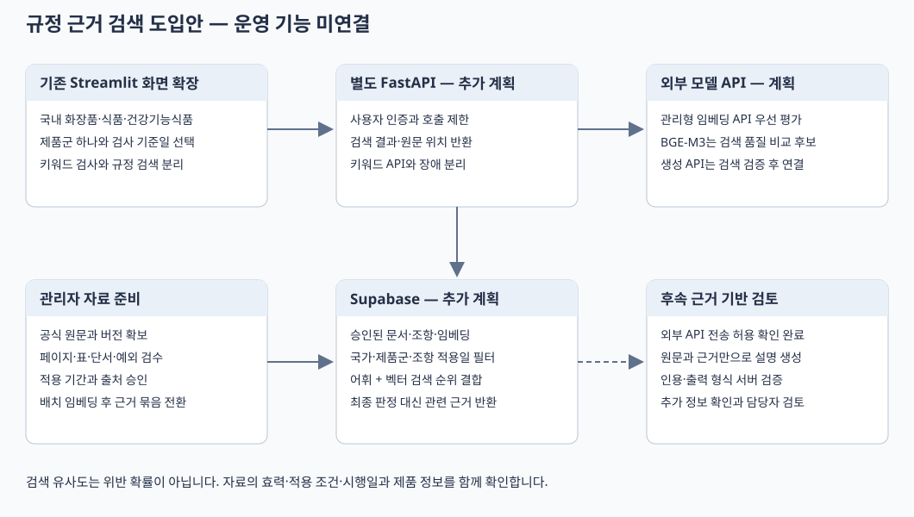

# 법령·가이드라인 근거 검색과 문맥 검토 설계

상태: **도입 제안 및 개발 기준 초안** · 갱신일: 2026-10-22 · 운영 기능 미연결

## 1. 결정 요약

현재 시스템에는 **기존 키워드 검사 + 검수된 공식 근거의 하이브리드 검색 + 선택적 AI 검토**가 적합합니다.
먼저 관련 조항과 원문 위치를 정확히 찾고, 검색 품질을 검증한 뒤 설명을 생성합니다.
관련 문서의 검색 점수는 위반 확률이 아닙니다. 광고 문구만으로 제품의 허가·심사·실증 자료를 알 수 없으므로
자동으로 적법 또는 위법을 확정하지 않습니다.

| 항목 | 초기 선택 | 이유와 변경 조건 |
|---|---|---|
| 사용자 화면 | 현재 Streamlit 유지 | 기존 로그인·권한·키워드 분석 재사용 |
| 규정 검색 | 기존 FastAPI에 별도 경로 추가 계획 | 키워드 분석과 분리해 지연·실패의 영향을 제한 |
| 근거 저장 | 기존 Supabase에 앱 전용 테이블과 pgvector 추가 계획 | 별도 벡터 DB 운영을 피함 |
| 임베딩 | 관리형 임베딩 API 우선 평가, BGE-M3와 비교 | 외부 전송 허용 조건에 따라 초기 모델 서버 운영 부담을 줄임. 제품군별 평가로 최종 선택 |
| 검색 조합 | 어휘 검색 + dense 검색을 RRF로 결합 | 조문명·금지 표현의 직접 일치와 의미가 비슷한 표현을 함께 찾음 |
| 재정렬 | 초기 평가 후 필요할 때 추가 | 누락은 적고 상위 결과의 순서가 문제일 때 검토 |
| 생성 모델 | 검색 검증 후 관리형 생성 API 연결 | 외부 전송 허용 확인 완료. 근거 검색과 인용 검증을 먼저 완성 |
| LangChain·LlamaIndex | 초기에는 추가하지 않음 | 현재의 Python·requests·FastAPI로 고정된 검색 흐름 구성 가능 |
| 운영 서버 | 화면은 Community Cloud, API 서버에서 외부 모델 호출 | 초기에는 자체 GPU·모델 프로세스 운영을 생략 |

**2026-10-22 사용자 확정 사항:** 1차 대상은 **화장품·식품·건강기능식품**이며 광고 문구의 외부 AI API 전송은 **허용**됩니다.
적용 국가는 기존 국내(KR) 설계를 유지합니다. 공산품·해외 광고는 후속 범위입니다.
세 제품군 모두 같은 순서로 공식 근거 확보와 검색 검증을 진행하고, 검수된 자료가 준비된 제품군부터 활성화합니다.
API 제공업체·계정·모델·요금 한도는 아직 선정하지 않았습니다. 특정 업체의 성능이나 데이터 보관 조건이 확인됐다는 뜻은 아닙니다.

이번 작업의 산출물은 이 설계서, 제안용 API 명세, 공식 출처 후보 목록, 평가 문항 초안과 오프라인 평가 도구입니다.
실제 법령 본문 적재, pgvector 활성화, 임베딩 모델 설치, API 경로와 화면 연결은 아직 수행하지 않았습니다.
현재 `openapi.json`, `api.py`의 운영 계약과 키워드 검출 결과는 이 설계 때문에 바뀌지 않습니다.

### 2026-10-22 실행 준비 상태

키워드 분석 리팩터링과 이 문서의 설계·평가 도구는 완료했습니다.
국가법령정보센터의 화장품법 제13조, 식품표시광고법 제8조, 표시광고법 제3조 페이지를
`data/regulations/source_snapshots`에 수집하고 출처·버전·해시를 별도 manifest에 기록했습니다.
수집본은 법률 검수 전이며 DB 적재·임베딩 생성·운영 검색에는 사용하지 않았습니다.

OpenAI 임베딩 연결 시험은 `429 / credit_balance_exhausted`로 실패했고 임베딩은 생성되지 않았습니다.
사용자 요청에 따라 **외부 AI API 연동을 후속 작업으로 보류**했습니다.
RAG용 Supabase 테이블·데이터 적재와 새 FastAPI 서버 배포도 아직 실행하지 않았습니다.
현재의 기존 Streamlit·Supabase 키워드 기능과 구분해 진행 상태를 관리합니다.

## 2. 현재 코드에서 이어 붙일 지점

| 현재 구현 | 규정 검사 확장 원칙 |
|---|---|
| `matching_engine.py`의 `MatchingConfig`와 매칭 모드 | 기존의 정확·유사·부분 매칭 유지. 의미 검색을 기존 유사일치 모드로 혼합하지 않음 |
| `service.py`를 Streamlit과 FastAPI가 공유 | 키워드 분석은 현재 경로 유지. 규정 검색만 별도 서비스 함수로 추가 |
| `repository.py`의 서버 전용 Supabase 접근 | 검색 RPC도 서버에서 호출. 브라우저에는 서버 키를 전달하지 않음 |
| Supabase Auth의 `app_metadata.role` | 로그인한 member/admin만 검색. 원문 등록·승인·철회는 admin 검증 후 수행 |
| 키워드별 조회수와 `kra_runs` | 관련 규정 검색으로 키워드 조회수를 올리지 않음. AI 관련 버전은 기존 키워드 revision과 분리 |
| Streamlit Community Cloud | 기존 화면 유지. 모델 서버 장애에도 키워드 검사는 계속 사용 가능하게 구성 |

로컬 CSV에는 식품 400건, 화장품 357건, 공산품 266건, USA 177건, 건강기능식품 110건,
일본 68건, 반려동물 40건, 공통 13건이 있습니다. 이는 검토 시점의 원장 분포입니다.
기존 키워드 결과의 카테고리 필터는 매칭 후 필터입니다. 법령 검색의 적용 국가·제품군은
**검색 후보를 만들기 전 필수 조건**으로 사용해야 합니다.

## 3. 전체 흐름



```text
[현재] 광고 원문 → 공통 키워드 엔진 → 검출 위치·위험 등급

[추가 계획] 사용자가 '관련 규정 찾기' 실행
    → FastAPI: 인증·분량·제품군·국가·적용일 검사
    → 관리형 임베딩 API: 질의 임베딩
    → Supabase: 검수·적용 기간 필터 → 어휘 검색 + 벡터 검색
    → 순위 결합 → 조항과 예외 문맥 복원 → 출처 카드

[후속] 사용자 요청 시 근거 기반 검토
    → 승인된 생성 모델 → 인용 ID·원문 위치 검증 → 담당자 검토

[별도 관리 작업] 공식 원문 수집 → 추출·구조화 → 검수
    → 임베딩 생성 → 새 근거 묶음 검증 → 활성 버전 전환
```

Streamlit은 키워드 분석을 공통 모듈로 직접 실행하고 규정 검색만 FastAPI로 요청합니다.
AI 서버를 호출하지 않은 결과를 AI 문맥 검사 완료로 표시하지 않습니다.
처음부터 에이전트, 다중 도구 호출, 작업 큐, 여러 벡터 DB를 도입할 필요는 없습니다.

## 4. BGE-M3와 생성 모델 선택

외부 API 전송이 허용됐으므로 초기에는 **관리형 임베딩 API + 관리형 생성 API** 조합을 우선 평가합니다.
BGE-M3는 동일한 광고·법령 자료로 비교할 후보로 유지합니다. BGE-M3를 선택하더라도
처음부터 자체 GPU를 운영하기보다 해당 모델을 제공하는 관리형 엔드포인트와 자체 운영 비용을 비교합니다.
검색 정확도·지연·월 비용이 자체 운영을 정당화할 때 전환합니다. 실제 외부 API 호출은 아직 수행하지 않았습니다.

BGE-M3 공식 모델 카드는 1024차원 임베딩, 최대 8192 토큰, 100개가 넘는 언어와
dense·sparse·multi-vector 검색 지원을 설명합니다. 저자는 하이브리드 검색과 재정렬을 권합니다.
이 특성은 후보 선정 근거이며 한국어 광고 심의에서 가장 우수하다는 보장은 아닙니다.
[BGE-M3 공식 모델 카드](https://huggingface.co/BAAI/bge-m3)

| 평가 대상 | 측정 목적 |
|---|---|
| 현재 키워드 검사 | 어떤 표현을 명시적으로 찾는지 비교하는 별도 기준. 법령 검색 정확도로 해석하지 않음 |
| 어휘 검색만 사용 | 임베딩 도입에 따른 실제 개선 확인 |
| 관리형 임베딩 API | 세 제품군의 한국어 관련성 검색, 지연, 호출·재색인 비용을 함께 비교 |
| BGE-M3 dense만 사용 | 표현이 달라도 관련 조항을 찾는지 확인 |
| 어휘 + BGE-M3 dense | 조문명과 문맥 검색을 함께 사용했을 때의 누락·순서 비교 |
| 하이브리드 + reranker | 상위 5개 근거의 품질 개선이 지연·운영 부담을 정당화하는지 확인 |

초기에는 선택한 모델의 dense 출력만 저장합니다. BGE-M3의 sparse·ColBERT까지 모두 운영하면 저장·검색·평가 경로가 늘어납니다.
어휘 검색과 dense 결합으로 부족한 문제가 확인되면 sparse 또는 reranker 중 필요한 하나를 평가합니다.
LangChain과 LlamaIndex는 RAG를 구성하는 도구이며 법령의 최신성이나 법률 판단 정확성을 보장하지 않습니다.
문서 종류와 처리 단계가 늘어나 기존 코드로 관리하기 어려워질 때 하나를 선택합니다.

후속 생성 모델은 특정 Llama-3-Korean 파생 모델로 미리 고정하지 않습니다.
모델별 한국어 근거 준수, 인용 정확도, 상업적 이용 조건, 문맥 길이, 실제 메모리와 응답 시간을 비교합니다.
외부 전송 허용 조건을 임베딩과 생성 단계에 모두 반영합니다. 회사의 범용 외부 전송 허용이
특정 업체의 보관·재학습·처리 지역 조건까지 확인했다는 의미는 아니므로 제공업체 선정 시 해당 조건을 기록합니다.
사용자 비밀번호·서버 키·계정 식별 정보는 모델 입력에 포함하지 않습니다.
서버에서 입력 길이·출력 토큰·사용자별 호출 수·재시도 횟수를 제한하고 API 키는 서버 Secrets에서 관리합니다.

## 5. 공식 근거 수집과 개정 관리

출처 후보 목록: [regulation_sources.json](reference/regulation_sources.json).
이는 게시 정보와 링크를 확인한 목록입니다. 검색용 본문, 법률 검수 또는 적재 완료 목록이 아닙니다.

### 세 제품군의 근거 묶음

| 선택 제품군 | 먼저 확보할 근거 | 별도로 확인할 제품 정보 |
|---|---|---|
| 화장품 (`cosmetics`) | 화장품법·시행규칙과 표시·광고 관리 지침 | 기능성 심사·보고 여부, 심사 내용, 실증 자료 |
| 식품 (`food`) | 식품표시광고법·시행령 별표 1, 부당한 표시·광고 내용 기준과 기능성 표시 예외 규정 | 식품 유형, 기능성 표시 적용 요건, 성분·함량·시험 조건 |
| 건강기능식품 (`health_functional_food`) | 식품표시광고법·시행령, 건강기능식품 표시기준과 해당 기능성 인정 근거 | 제품 신고·인정 정보, 인정 기능성, 섭취량·대상·주의 사항, 광고 심의 자료 |

표시광고법 등 공통 근거는 검수자가 승인한 적용 제품군 배열에 세 코드를 명시합니다.
식품과 건강기능식품이 일부 법령을 공유해도 한 제품군의 모든 예외·허용 범위를 다른 제품군에 복사하지 않습니다.
일반 식품의 기능성 표현도 적용 요건과 예외 근거를 검색하며, 단순히 기능성이라는 표현만으로 판정을 만들지 않습니다.
건강기능식품도 기능성 인정 정보 없이 모든 효능 표현을 허용한다고 가정하지 않습니다.
[식품표시광고법 제8조](https://www.law.go.kr/LSW/lsLinkCommonInfo.do?chrClsCd=010202&lsJoLnkSeq=1029094361),
[일반 식품 기능성 표시·광고 규정](https://law.go.kr/LSW/admRulLsInfoP.do?admRulId=75449&efYd=0)

광고 문구에서 제품군을 자동 추측해 검사 범위를 바꾸지 않습니다. 요청당 제품군 하나를 명시적으로 선택하고
입력이 불명확하면 제품 정보를 확인합니다. `전체` 선택으로 세 제품군의 조항을 섞어 반환하지 않습니다.

1. 국가법령정보센터의 법률·시행령·시행규칙·고시와 식약처·공정위의 공식 문서를 우선 등록합니다.
2. 문서 제목, 소관 기관, 문서 종류, 공포·게시일, 원문 URL과 조회 시점을 기록합니다.
3. 원본 파일 또는 공식 응답을 보관하고 SHA-256을 계산합니다. 현재 내용을 돌려주는 링크만으로 버전을 식별하지 않습니다.
4. 조·항·호·목·별표 행 단위로 구조화합니다. PDF의 표는 금지 표현, 허용 조건, 예외를 같은 의미 단위로 보존합니다.
5. 원문 페이지와 추출문을 대조합니다. OCR 오류, 표 행의 섞임, 각주와 예외 누락이 있으면 승인하지 않습니다.
6. 조항별 적용 시작일과 종료일, 제품군·국가, 상위 조문과 참조 조문을 검수합니다.
7. 승인된 자료만 새 근거 묶음에 넣고 검색·인용·날짜 검증 후 활성화합니다.

법률, 고시, 민원인안내서, 사례집을 화면에서 구분합니다. 민원인안내서를 법률과 같은 효력의 규정으로 표시하지 않습니다.
뉴스·블로그·판매자 설명은 초기 규정 근거에서 제외합니다. 추후 사례 검색이 필요하면 별도 유형과 화면으로 분리합니다.

### 적용일은 문서가 아닌 조항 단위

2026-10-21 공식 조문 페이지에서는 화장품법에 **법률 제22113호, 시행 2026-10-20**이 표시됐습니다.
검색엔진의 이전 수집 결과에는 **제21525호, 시행 2026-10-08**이 남아 있었습니다.
같은 법의 개정문에는 **2026-11-27 시행**인 변경도 확인됩니다.
따라서 검색엔진 요약이나 문서 머리의 날짜 하나를 모든 조항의 시행일로 복사하면 안 됩니다.
[화장품법 조문 페이지](https://www.law.go.kr/LSW/lsLinkCommonInfo.do?chrClsCd=010202&lsJoLnkSeq=1027656895),
[별도 시행일이 있는 개정문](https://law.go.kr/LSW/lsInfoP.do?lsiSeq=286275&viewCls=lsRvsDocInfoR)

기간은 `valid_from <= as_of < valid_to`로 판단하고 종료일이 없으면 상한을 두지 않습니다.
한 적용일에 같은 조항의 서로 다른 버전이 동시에 선택되면 근거 묶음의 배포를 차단합니다.
장래 조항은 보관할 수 있지만 현재 광고 검사 결과에 섞지 않습니다.
과거 기준일은 해당 시점 자료가 검수된 경우에만 지원하며, 자료가 없으면 현재 법으로 대신 판단하지 않습니다.

건강기능식품 표시기준 역시 2026-66호 페이지에 2028-01-01 시행이 표시돼 있습니다.
공포·게시 시점과 조항 적용일을 구분하고, 현행과 장래 버전을 함께 확보해 부칙과 경과조치를 검수해야 합니다.
[장래 시행 표시기준](https://www.law.go.kr/LSW/admRulInfoP.do?admRulSeq=2100000285156&chrClsCd=010201)

### 갱신과 철회

관리자가 공식 출처 변경을 정기 확인하고, 변경 해시가 다르면 새 버전을 검수합니다.
초기 운영은 주 1회 확인과 주요 개정 공지 시 수시 확인을 제안합니다. 자동 수집만으로 자동 승인하지 않습니다.
자료마다 `review_due_on`을 두고, 검수 기한이 지나거나 오류가 확인된 자료는 검색 대상에서 제외합니다.
기한 내라는 사실도 법적 최신성을 보증하지 않으므로 화면에는 마지막 확인일과 원문 링크를 함께 표시합니다.

## 6. 청킹과 검색 규칙

| 단계 | 초기 설계 |
|---|---|
| 원문 보존 | 인용할 텍스트와 검색용 텍스트를 구분. 원문은 기존 매칭 엔진의 기호 제거 규칙으로 바꾸지 않음 |
| 의미 단위 | 조항·별표 행 우선. 목표 300~700 토큰, 최대 1000 토큰은 평가용 초기값 |
| 예외·단서 | 조건·금지·예외가 분리되면 부모 또는 연결 ID로 반드시 함께 복원 |
| 임베딩 입력 | 제목, 조문 경로, 제품군 설명, 해당 본문을 일정 형식으로 구성 |
| 긴 광고 | 초기 요청 최대 2000자. 문장별 질의로 나누되 부정·조건·인용 문맥을 함께 유지. 조용히 자르지 않음 |
| 필수 필터 | 활성 근거 묶음, 승인 상태, 검수 기한, 국가, 요청한 단일 제품군, 조항 적용 기간, 임베딩 프로필 |
| 후보 수 | 어휘 상위 20 + 벡터 상위 20, 문장별 결과를 중복 제거 후 결합하는 값으로 시작 |
| 순위 결합 | RRF: 각 검색 순위 r에 대해 1 / (60 + r)를 더함. 60과 후보 수는 평가 후 조정 |
| 반환 | 기본 5개, 최대 10개 주 근거. 같은 조항의 중복 청크를 묶고 필요한 부모·예외 문맥은 각자의 출처와 함께 첨부 |

Supabase는 어휘 검색과 의미 검색을 결합하는 하이브리드 검색 예시를 제공합니다.
기존 점수의 크기가 다른 두 검색을 단순 합산하는 대신 순위를 결합하는 구성을 기준으로 삼습니다.
[Supabase 하이브리드 검색](https://supabase.com/docs/guides/ai/hybrid-search)

한국어 어휘 검색을 PostgreSQL `simple` FTS만으로 해결했다고 가정하지 않습니다.
조사·어미와 띄어쓰기 변화가 있으므로 `simple` FTS에 검수된 검색어를 함께 넣는 기준과
`pg_trgm`의 부분 어휘 검색을 실제 문항으로 비교한 뒤 선택합니다. `pg_trgm`은 BM25가 아닙니다.
이후에도 어휘 검색 품질이 부족하면 PGroonga 등 한 가지 확장을 검토합니다.
무조건 상위 N개를 의미 있는 근거로 간주하지 않으며, 보류 기준은 평가 데이터에서 정합니다.
모델과 자료가 바뀌면 같은 cosine 임계값을 그대로 재사용하지 않습니다.

## 7. Supabase 논리 설계 — 미적용

2026-10-21 읽기 전용 확인 시 프로젝트에 `vector`, `pg_trgm`, `pgroonga`는 설치되어 있지 않았습니다.
설치 가능 목록에는 vector 0.8.0, pg_trgm 1.6, PGroonga 3.2.5가 표시됐습니다.
이번 작업에서는 확장·테이블·권한을 생성하거나 변경하지 않았습니다.

| 추가 예정 테이블 | 핵심 필드 | 불변 조건 |
|---|---|---|
| `kra_regulation_documents` | id UUID, corpus_version, source_key, source_version, title, authority, source_kind, jurisdiction, source_url, 원본 보관 경로, content_sha256, published_on, review_status, verified_at/by, review_due_on | 승인된 본문은 덮어쓰지 않음. 변경은 새 문서 버전. URL만으로 유일성 판단 금지 |
| `kra_regulation_chunks` | id UUID, document_id FK, provision_key, citation_label, 원문 content, 검색용 search_text, parent_id, 관련 조항 ID, category_codes, valid_from/to, locator, content_sha256 | 적용 시작일·정확한 위치·본문 필수. 같은 조항의 활성 버전 중복과 기간 역전 금지 |
| `kra_regulation_embeddings` | chunk_id FK, embedding_profile_id, provider, model_id, model_revision NULL 가능, dimensions, preprocessing_version, input_sha256, embedding vector(N) | N은 선택 모델의 출력 차원으로 배포 시 고정. 청크·프로필 조합 유일. 서로 다른 프로필의 벡터 혼합 금지 |

`source_kind`는 statute / decree / rule / notice / guideline으로 구분합니다.
`locator`에는 조·항·호·목, 별표·표 행, PDF 실제 페이지와 인쇄 페이지를 구분해 기록합니다.
부분 개정이나 연결 문맥을 포함한 적용 여부는 청크별로 검수합니다.
원본 파일은 비공개 보관소에 두고 화면에는 검증된 공식 URL을 제공합니다.
`category_codes`는 cosmetics / food / health_functional_food 중 승인된 적용 범위를 담습니다.
문서가 공통 법령이어도 해당 청크의 적용 조건을 따로 검수하며, 출처 후보의 분류만으로 승인하지 않습니다.

초기에는 운영 설정의 `REGULATION_CORPUS_VERSION` 하나로 검증된 근거 묶음을 선택하는 구성이 충분합니다.
모든 적재와 검증이 끝난 뒤 설정을 전환하며 이전 묶음은 되돌리기용으로 보존합니다.
승인·철회·검수 기한은 매 검색 시 확인합니다. 기존 `kra_state.revision`은 규정 적재로 변경하지 않습니다.

보안은 기존 앱의 서버 전용 방식을 따릅니다. 새 public 테이블에 RLS를 켜고
PUBLIC·anon·authenticated의 직접 접근을 허용하지 않습니다. 서버 역할에 필요한 권한만 부여하고
검색 RPC는 SECURITY INVOKER, 고정 search_path와 명시적 스키마를 사용합니다.
관리자 승인 작업은 Auth 서버에서 역할을 재검증합니다. 서버 키가 RLS를 우회하므로 API 권한 검사는 필수입니다.

필터용 B-tree와 외래키 인덱스부터 구성합니다. 소규모 근거 묶음은 정확 벡터 검색을 기준으로 측정하고,
데이터 증가로 지연 목표를 넘으면 cosine HNSW 인덱스를 추가합니다.
ANN을 사용할 때 국가·기간 필터 뒤 결과가 부족해지는 문제를 평가해야 하며,
필터를 완화해서 결과 개수를 채우면 안 됩니다.
[Supabase 벡터 인덱스](https://supabase.com/docs/guides/ai/vector-indexes)

비교 후보 `BAAI/bge-m3`에 대해 확인한 모델 revision은
`5617a9f61b028005a4858fdac845db406aefb181`입니다. 이는 다운로드·동작 검증 완료 표시가 아닙니다.
실제 환경에서는 제공업체·모델 ID·출력 차원·전처리·정규화·최대 길이를 고정한 임베딩 프로필을 사용합니다.
BGE-M3를 선택하면 N=1024이며 다른 모델을 선택하면 그 출력 차원과 인덱스 지원 범위를 확인합니다.
모델을 바꿀 때는 질의만 바꾸지 않고 근거 묶음도 새 프로필로 재임베딩한 후 검증·전환합니다.
관리형 API가 고정 revision을 공개하지 않으면 `model_revision=null`로 기록하고 버전이 고정됐다고 주장하지 않습니다.
요청·응답 모델 ID와 프로필·생성 시점을 기록하고, 고정된 합성 문장으로 변화를 점검합니다.
정확한 재현성이 필요한 경우 revision 고정이 가능한 제공 방식을 선택합니다.

## 8. API 초안 — 현재 API와 분리

기계 판독용 제안: [regulation_openapi.proposed.json](reference/regulation_openapi.proposed.json).
이 파일은 현재 앱이 제공하는 OpenAPI에 합쳐지지 않으며 엔드포인트도 아직 등록되지 않았습니다.

| 항목 | 제안 |
|---|---|
| 경로 | POST `/api/v1/regulations/search` |
| 인증 | Supabase 사용자 access token, member/admin. 기존 공유 `API_ACCESS_TOKEN`은 초기 AI 검색에서 403 |
| 입력 | text 1~2000자, jurisdiction=KR, category=cosmetics / food / health_functional_food 중 하나, as_of=검사 기준일, top_k=1~10 |
| 추가 검증 | 공백 입력 거부. 초기에는 오늘을 포함한 과거의 검수된 기준일만 지원. 지원되지 않는 제품군·날짜는 422 |
| 결과 | 관련 조항, 원문 발췌, 공식 URL, 정확한 위치, 버전·시행 기간·검수일, 검색 순위 |
| 결과 상태 | ok / insufficient_evidence. 근거 없음은 적법 판정이 아님 |
| 운영 오류 | 429 호출 제한, 503 근거 미준비·모델/DB 장애. 장애를 근거 없음으로 처리하지 않음 |
| 저장 | 초기에는 광고 원문과 결과 본문을 영구 저장하지 않음. 요청 ID·처리 시간·오류 코드·근거 버전만 기록 |

기존 키워드 검사와 규정 검색은 각각 실행·응답합니다. `/api/v1/analyses`에 무거운 작업을 끼워 넣지 않습니다.
규정 검색 실패 때문에 이미 완료한 키워드 검사를 실패로 돌리지 않습니다.
인증 토큰과 광고 문구를 URL, 프록시·애플리케이션 로그, 오류 메시지에 남기지 않습니다.
호출 제한은 서버에서 사용자별로 적용하며 Streamlit 버튼 비활성화만으로 대신하지 않습니다.

## 9. 화면 초안

### 일반 사용자: 분석 결과 아래 별도 영역

표제: **관련 규정 찾기**

설명: **광고 문구와 관련된 법령·가이드라인을 찾습니다. 제품 정보와 실증 자료에 따라 추가 검토가 필요할 수 있습니다.**

입력: 적용 국가(KR), 제품군(화장품 / 식품 / 건강기능식품 중 하나), 검사 기준일.
제품군을 명시적으로 선택하게 하며 실제 검수·활성화된 근거 범위를 표시합니다. 미지원 범위는 실행하지 않습니다.
버튼: **이 문구의 관련 규정 찾기**. 입력할 때마다 자동으로 모델을 호출하지 않습니다.

결과 카드에는 문서 종류, 조항 제목, 원문 발췌, 예외·조건, 적용 기간,
마지막 검수일과 **공식 원문 보기** 링크를 제공합니다. 검색 순위는 표시할 수 있지만
유사도 83%를 위반 확률 83%로 표시하지 않습니다.
기존 키워드 위험 등급과 별개 영역으로 보여줍니다.

| 상황 | 표시 문구 |
|---|---|
| 검색 성공 | 관련 조항 N개를 찾았습니다. 적용 조건과 원문을 확인하세요. |
| 근거 부족 | 검수된 자료에서 충분한 근거를 찾지 못했습니다. 문제가 없다는 의미는 아닙니다. |
| 제품 정보 부족 | 기능성 심사 여부·시험 조건 등 추가 정보가 필요합니다. |
| 미지원 범위 | 이 국가·제품군·기준일의 규정 검사는 아직 지원하지 않습니다. |
| 모델 장애 | 규정 검색을 일시적으로 사용할 수 없습니다. 키워드 검사 결과는 확인할 수 있습니다. |

### 관리자: 규정 자료 관리

관리자만 출처 등록, 추출문 미리보기, 페이지 대조, 조항 적용 기간 수정, 승인·철회를 수행합니다.
처음에는 검수 파일과 관리 스크립트로 시작하고, 반복 관리 수요가 확인되면 관리 화면을 추가합니다.
일반 사용자에게 모델명·차원·임베딩 옵션·수집용 입력창을 노출하지 않습니다.

## 10. 후속 AI 검토의 출력과 검증

검색 품질을 통과한 후 **근거 기반 검토**를 추가합니다. 초기 검색 API에는 판정 필드를 넣지 않습니다.
후속 검토는 문장별로 `needs_review` / `insufficient_information` / `no_issue_identified`를 반환하도록 설계합니다.
마지막 상태는 제한된 자료에서 문제를 식별하지 못했다는 의미이며 적법 인증이 아닙니다.

| 필드 | 검증 규칙 |
|---|---|
| original_span | 원문의 시작·끝 code point와 정확히 일치하는 인용 |
| evidence_ids | 이번 요청에서 실제 반환한 청크 ID만 허용 |
| explanation | 근거 조항과 광고 표현의 관계 설명. 근거에 없는 요건을 만들지 않음 |
| missing_facts | 기능성 심사 여부, 시험 대상·기간·조건 등 판단에 부족한 정보 |
| suggested_revision | 선택적 수정 제안. 수정하면 법적 안전성이 보장된다고 설명하지 않음 |

생성 모델에 광고와 문서 내용은 분석 대상 데이터로 전달합니다. 문서 안의 지시를 실행하지 않고
웹 접근·SQL·사용자 관리 도구를 제공하지 않습니다. 출력은 구조화해 파싱하고 인용 ID·원문 위치를 서버에서 확인합니다.
스키마 오류나 인용 불일치가 있으면 검토 결과를 보류하고 확인된 근거만 제공합니다.
허용 사례·부정문·인용문·조건문을 함께 평가하며, 단순히 금지 표현과 의미가 비슷하다는 이유로 모두 위험 처리하지 않습니다.
이미지·배치·음성·전체 상세페이지의 인상은 초기 텍스트 검사 범위에 포함되지 않습니다.

## 11. 배포와 장애 격리

| 구성 요소 | 초기 운영 방안 |
|---|---|
| Streamlit | 현재 Community Cloud 유지. 기존 requirements에 Torch·FlagEmbedding을 추가하지 않음 |
| 규정 검색 API | 현재 FastAPI 코드베이스에 추가하되 별도 서버에서 운영. Render는 후보이며 필수 아님 |
| 임베딩 | 관리형 임베딩 API 우선 평가. 초기에는 자체 모델 프로세스·GPU 서버를 운영하지 않음 |
| 본문 추출·적재 | 관리자 수동 배치. 사용자 요청 중 PDF 다운로드·OCR·재임베딩 금지 |
| PostgreSQL | 기존 Supabase의 앱 전용 테이블. 초기 정확 검색 후 필요 시 벡터 인덱스 |
| 생성 LLM | 외부 API 전송 허용 확인 완료. 검색·인용 평가를 통과한 후 관리형 생성 API 연결 |

Community Cloud는 자원 한도가 있는 공유 실행 환경입니다. 화면에서 모델을 로딩하지 않고
서버에서 관리형 API를 호출하는 선택은 이 제약과 초기 운영 부담을 고려한 설계 판단입니다.
자체 운영은 실제 품질·지연·사용량에서 전환 필요성이 확인될 때 검토합니다.
[Streamlit 앱 운영 문서](https://docs.streamlit.io/deploy/streamlit-community-cloud/manage-your-app)

API 키는 FastAPI 서버의 환경 변수·Secrets에만 보관합니다. 브라우저에 직접 모델 API 키를 전달하지 않습니다.
생성 단계에는 필요한 광고 문장·제품 정보·검색된 근거만 보내고 불필요한 계정 정보나 내부 원장을 함께 전송하지 않습니다.
월 예산과 호출 한도를 정하고 실제 사용량으로 비용을 확인합니다. 외부 전송 허용을 무제한 호출로 해석하지 않습니다.

초기 제안 목표는 외부 API 왕복을 포함한 근거 검색 p95 5초 이내, 요청 전체 제한 시간 20초입니다.
이는 보장 수치가 아닙니다. 1·5·10 동시 사용자, 최초 로딩, DB 장애·모델 장애로 검증합니다.
타임아웃을 무제한 재시도하지 않고 사용자에게 재시도를 안내합니다.
비용은 서버 가동 시간, Supabase 자원·저장량, 월 요청 수와 모델 사용량으로 산정한 뒤 호스팅을 선택합니다.

## 12. 평가와 도입 순서

평가 문항 초안: [regulation_eval_cases.jsonl](reference/regulation_eval_cases.jsonl).
실제 법률 검토를 거친 정답이 아니므로 모두 draft이며, 아직 검색 정확도 수치를 산출할 수 없습니다.
원문 적재 후 담당자가 버전별 provision ID에 관련성 정답과 검색 금지 ID를 부여하고 approved로 바꿉니다.
정답은 '위반 여부'가 아닌 '찾아야 할 근거'입니다. 무관 문장도 광범위한 일반 조항과 관련될 수 있어
근거 없음 정답 역시 담당자 검수가 필요합니다.

| 단계 | 작업 | 완료 기준 |
|---|---|---|
| 1 | 국내 세 제품군·외부 전송 허용 조건 반영, 담당 검수자와 API 제공 방식 선정 | 제품군과 전송 허용은 확정. 문서 승인 책임자·제공업체·모델·예산은 선정 필요 |
| 2 | 출처 후보의 원문 확보·청킹·적용일 검수 | 출처·위치·해시·기간 누락 0건, 예외와 표 대조 완료 |
| 3 | 세 제품군 각 30개 이상, 총 100개 이상의 관련 조항 라벨 작성 | 일반·변형·부정·조건·제품군 혼동·개정 전후를 포함한 승인 문항 |
| 4 | 어휘/관리형 임베딩/BGE-M3/하이브리드 오프라인 비교 | 제품군별 Recall·MRR·지연과 호출·재임베딩 비용 측정 |
| 5 | Supabase 스테이징에 새 구조·검색 RPC 구현 | 날짜·검수·권한 필터 통과, 운영 DB 변경 전 재현 가능한 migration |
| 6 | FastAPI와 Streamlit에 근거 검색 연결 | 인증·호출 제한·오류 격리·원문 링크와 위치 확인 |
| 7 | 사내 파일럿 후 생성 모델 검토 | 실제 누락 유형을 보완한 뒤 인용 검증과 사람 검토 절차 적용 |

초기 검색 목표 제안: 승인된 관련성 문항 Recall@10 ≥ 0.90, MRR@10 ≥ 0.80,
다른 국가·제품군·기간·미승인 근거의 반환 0건입니다. 담당자가 검수한 최소 100문항의 별도 평가 묶음에서
전체와 각 제품군을 각각 확인합니다. 하나의 제품군이 목표를 넘겨도 다른 제품군의 부족한 품질을 상쇄하지 않습니다.
이 수치는 현재 측정 결과가 아니며, 소수의 예시 문항으로 통과를 주장하지 않습니다.
모델·청킹·질의 확장·임계값 조정에 사용한 문항과 최종 평가 문항을 분리합니다.

추가 의존성 없이 실행하는 평가 도구:

```powershell
.\.venv\Scripts\python.exe scripts/evaluate_regulation_retrieval.py `
  --cases path/to/approved_cases.jsonl `
  --results path/to/retrieval_results.jsonl `
  --output path/to/metrics.json
```

정답 JSONL 한 줄에는 `case_id`, `category`, `judgment_status=approved`, `relevant_ids`, `forbidden_ids`가 필요합니다.
`evaluation_type`이 scope 또는 generation_safety인 문항은 관련성 집계에서 제외하며 별도 검수합니다.
결과 JSONL 한 줄에는 같은 `case_id`, 순서대로 정렬한 `retrieved_ids`, `latency_ms`, `abstained`가 필요합니다.
ID는 `source_key::source_version::provision_key`처럼 버전이 포함된 평가용 키를 사용합니다.
근거 없음 정답은 `relevant_ids=[]`, 아직 정답을 모르는 문항은 `null`로 구분합니다.
도구는 미승인 문항을 정답으로 사용하지 않으며 승인 문항의 결과 누락·중복·알 수 없는 문항 ID가 있으면 실패합니다.
전체와 제품군별 Recall@5/10, MRR@10, 근거 없음 보류 정확도, 금지 근거 반환율@10, 지연 p50/p95를 계산합니다.
이 도구는 모델 실행·임베딩 생성·법률 판단을 수행하지 않습니다.
금지 근거 지표는 라벨에 적힌 ID와 주 근거 상위 10개만 비교합니다.
실제 날짜·국가 필터와 연결된 예외 문맥의 적격성은 DB·API 통합 검증으로 별도 확인해야 합니다.

가장 먼저 할 실제 개발은 **공식 원문 확보와 관련 조항 정답 작성**입니다.
검색 품질의 기준 없이 LLM·GPU·프레임워크부터 추가하면 모델이 틀린 이유를 구분하기 어렵습니다.
