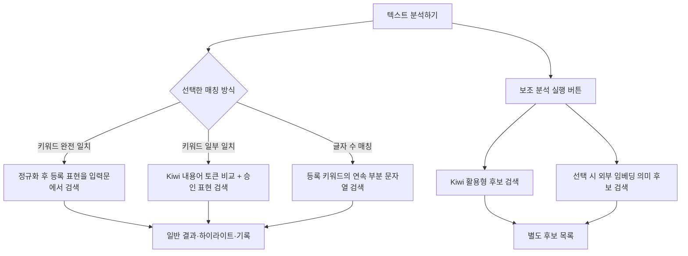

# FIXED272 키워드 매칭 방식 안내

이 문서는 FIXED272 코드의 현재 동작을 기준으로, 분석 화면의 세 가지 매칭 방식과 별도 실행하는 보조 분석을 설명합니다. 여기서 “검출”은 문구가 등록 키워드와 관련 규칙에 맞아 결과에 포함되는 것을 뜻합니다. 분석 화면의 이름만으로 내부 로직을 추정하지 않도록, 각 방식의 실제 비교 단위와 한계도 함께 적었습니다.

## 먼저 구분할 점

일반 분석에는 세 가지 중 한 가지 모드가 적용됩니다. Kiwi 형태소 보조 분석은 이 모드 선택과 별개인 추가 후보 검색입니다.

일반 분석에서 검출된 결과는 기존 결과표와 하이라이트, 조회 기록에 반영됩니다. 보조 분석 결과는 별도 후보 목록으로 표시되며 일반 분석의 결과 건수·하이라이트·조회 기록에는 합쳐지지 않습니다.

## 네 가지 방식 비교

| 방식 | 실행 시점 | 비교 단위 | Kiwi 사용 | 일반 결과에 반영 |
| --- | --- | --- | --- | --- |
| 키워드 완전 일치 | 일반 분석에서 선택 | 등록 표현 전체를 정규화한 뒤 입력문 안에서 검색 | 아니요 | 예 |
| 키워드 일부 일치 | 일반 분석에서 선택 | Kiwi가 추출한 내용어 토큰 또는 관리자 승인 표현 | 예 | 예 |
| 글자 수 매칭 - 탐색용 | 일반 분석에서 선택 | 등록 키워드에서 만든 연속 문자열 조각 | 아니요 | 예 |
| Kiwi 형태소 보조 분석 | ‘보조 분석 실행’ 버튼을 별도로 누름 | Kiwi가 남긴 토큰의 순서 있는 연속 일치 | 예 | 아니요, 별도 후보로 표시 |

### 1. 키워드 완전 일치

등록 키워드(또는 설정에 따라 괄호 설명을 제거한 표현)를 입력문과 비교합니다. 공백 정규화, 영문 대소문자 무시, 설정 기호 처리 등 선택한 표기 옵션이 비교 전에 적용될 수 있습니다. 이 과정은 문자 비교이며 형태소나 의미를 분석하지 않습니다.

“완전 일치”는 **등록 표현 전체가 입력문 안에 나타나는지**를 뜻합니다. 입력문 전체가 등록 키워드와 같아야 한다는 뜻은 아닙니다. 현재 검색은 단어 경계를 강제하지 않으므로 등록 `피부`는 입력 `피부과` 안에서도 검출될 수 있습니다.

| 예시 | 결과 | 이유 |
| --- | --- | --- |
| 등록 `안티에이징` / 입력 `안티에이징으로 관리` | 검출 | 등록 표현 `안티에이징` 전체가 입력문 안에 있음 |
| 등록 `피부` / 입력 `피부과 상담` | 검출 가능 | 단어 경계가 아니라 문자열 포함으로 검색 |
| 등록 `피부 보습` / 입력 `피부보습` | 옵션에 따라 검출 | 공백 정규화 설정에 따라 표기가 정리될 수 있음 |

### 2. 키워드 일부 일치

FIXED272 일반 분석의 이 모드에서는 Kiwi가 등록 키워드와 입력문을 각각 형태소 단위로 나눈 뒤, 조사·어미 등은 제외하고 명사·동사·형용사 등 지정된 내용어 품사를 비교합니다. **비교에 쓰는 각 내용어 토큰과 승인 표현은 공백을 제외하고 최소 2글자여야 합니다.** 따라서 `더`, `있`, `선`처럼 한 글자인 토큰만으로는 검출되지 않습니다. 입력의 토큰 시작과 끝 위치를 사용해 원문에서 검출 구간을 표시합니다. 따라서 보조 분석 버튼을 누르지 않아도 이 모드를 선택하면 일반 분석 경로에서 Kiwi를 사용합니다.

또한 관리자가 등록 키워드 안에 포함된 2글자 이상의 표현을 승인 표현으로 지정했다면 그 표현도 검색합니다. 승인 표현은 입력문 안에서 내용어 토큰 경계에 맞아야 합니다. 예를 들어 등록 `안티에이징`, 승인 표현 `에이징`, 입력 `집중 에이징 관리`라면 승인된 `에이징`이 토큰 경계에 놓인 경우 검출 후보가 됩니다. `티에이`처럼 임의의 글자 조각을 자동으로 만들어 검색하지는 않습니다.

| 예시 | 결과 | 이유 |
| --- | --- | --- |
| 등록 `피부` / 입력 `피부가 건조하다` | 검출 가능 | Kiwi에서 공통 내용어 토큰 `피부`가 확인되면 조사 `가`를 제외하고 해당 토큰 구간을 표시 |
| 등록 `안티에이징` / 입력 `티에이` | 미검출 | 등록 토큰이나 승인 표현이 일치하지 않음. 글자 조각을 자동 검색하지 않음 |
| 등록 키워드에 `더`만 공통 토큰으로 있음 / 입력 `더` | 미검출 | 한 글자 내용어 토큰은 비교 대상에서 제외 |
| 등록 `안티에이징` / 승인 `에이징` / 입력 `집중 에이징 관리` | 경계에 따라 검출 | 승인 표현의 문자 일치와 내용어 토큰 시작·끝 경계를 함께 확인 |

**현재 구현의 중요한 세부사항:** 등록 키워드에서 내용어 토큰이 여러 개 나오더라도, 일반 일부 일치는 그 토큰을 전부 한꺼번에 요구하지 않습니다. 코드상 등록 키워드의 내용어 토큰을 후보 집합으로 만든 뒤 입력 쪽에서 그중 일치하는 토큰을 찾습니다. 따라서 등록 `피부 장벽`의 분석 결과가 `피부`, `장벽` 두 토큰이라면 입력에 그중 하나만 있어도 검출될 수 있습니다. “양쪽의 내용어 토큰 전체가 모두 일치해야 한다”는 더 엄격한 설계와는 현재 동작이 다릅니다.

Kiwi의 사전과 문맥 분석 결과에 따라 복합어나 전문 용어가 하나의 토큰으로 남거나 여러 토큰으로 나뉠 수 있습니다. 자동 분석이 원하는 단위로 나누지 않는 전문 용어는 승인 표현으로 보완하는 설계입니다.

### 3. 글자 수 매칭 - 탐색용

등록 키워드의 연속된 부분 문자열들을 만들고, 최소 글자 수 이상인 조각이 입력문에 있는지 찾습니다. 입력문도 등록 키워드도 형태소 분석하지 않으며 단어 경계도 요구하지 않습니다. 설정한 최소 글자 수보다 짧은 등록 키워드는 이 조건으로 검색하지 않습니다.

예를 들어 등록 `안티에이징`, 최소 3글자일 때 입력 `티에이`에는 등록 표현의 연속된 `티에이`가 포함되어 있어 검출될 수 있습니다. 이 방식은 넓게 탐색하기 좋지만, 의미가 약한 글자 조각까지 찾을 수 있으므로 정식 판정용보다는 후보를 살펴보는 용도에 가깝습니다.

| 예시 | 결과 | 이유 |
| --- | --- | --- |
| 등록 `안티에이징` / 최소 3글자 / 입력 `티에이 관리` | 검출 | 등록 표현의 연속된 3글자 조각 `티에이`가 입력에 존재 |
| 등록 `안티에이징` / 최소 4글자 / 입력 `티에이 관리` | 미검출 | 일치 조각이 최소 4글자에 못 미침 |
| 등록 `안티에이징` / 입력 `안티에이징 케어` | 검출 | 긴 연속 부분 문자열도 최소 글자 수를 충족 |

### 4. Kiwi 형태소 보조 분석

이 기능은 일반 매칭 모드와 별도로 보조 분석 영역에서 실행 버튼을 눌러야 작동합니다. 선택한 키워드 DB의 등록 표현과 입력문을 Kiwi로 분석하고, 조사·어미 등 지정된 품사를 제거한 뒤 등록 키워드 토큰이 입력 토큰 안에서 **같은 순서로 연속해서** 나타나는지 찾습니다. 일반 일부 일치와 달리 키워드의 내용어 토큰 시퀀스가 통째로 맞아야 합니다.

| 등록 키워드 | 입력 문장 | 후보 결과의 의미 |
| --- | --- | --- |
| `개선하다` | `사용감이 개선했어요` | Kiwi가 활용형을 같은 어간 토큰으로 정리하면 형태소 후보로 제안 가능 |
| `피부 장벽` | `피부 탄력 관리` | 등록 토큰 두 개가 연속 일치하지 않아 후보가 되지 않음 |

이 결과는 어디까지나 검토할 후보입니다. 일반 결과표, 하이라이트, 키워드 조회 수, 분석 기록에는 반영되지 않으며 사용자가 직접 판단해야 합니다. Kiwi 설치나 분석에 문제가 있으면 보조 후보 상태가 unavailable로 표시되고 일반 분석 결과와는 분리됩니다.

보조 분석 영역에는 임베딩 의미 검색도 있습니다. 이를 선택하고 실행하면 입력 문장과 키워드 설명을 외부 임베딩 API에 보내 관련도 후보를 찾습니다. 이는 형태소 일치가 아니라 의미 유사도 기반의 별도 후보 검색이며, 역시 일반 검출 결과로 자동 확정되지 않습니다.

## 실제 동작을 읽을 때 주의할 점

- 화면의 세 모드는 동시에 적용되지 않고, 일반 분석 때 선택된 한 모드만 사용합니다.
- 공백·기호·대소문자 등 비교 옵션은 문자 표기를 정규화하는 규칙입니다. Kiwi 형태소 분석이나 의미 판단과는 별개입니다.
- 일반 일부 일치의 Kiwi 토큰 검사는 “키워드의 모든 내용어 토큰을 요구하는 완전한 구문 매칭”이 아닙니다. 한 토큰만 공유해도 검출 가능한 현재 로직입니다.
- 글자 수 매칭은 부분 문자열을 적극적으로 찾으므로 오검출 가능성이 가장 높습니다. 화면에서 탐색용이라고 표시한 이유입니다.
- 승인 표현은 등록 키워드에 실제로 포함된 문자열만 허용하는 보완책이며, 동의어를 임의로 추가하는 기능이 아닙니다.
- 보조 분석 후보는 확정된 탐지나 법률 판단이 아닙니다. 사람이 검토할 추가 단서입니다.

## 관련 코드

- [`keyword_app2_fixed272.py`](../../keyword_app2_fixed272.py): 화면의 모드 선택, 일반 분석 호출, 보조 분석 실행과 결과 표시
- [`approved_matching.py`](../../approved_matching.py): 일반 일부 일치의 Kiwi 내용어 토큰 비교와 승인 표현 검색
- [`matching_engine.py`](../../matching_engine.py): 완전 일치, 문자 부분 문자열 매칭, 모드별 비교 준비
- [`auxiliary_analysis.py`](../../auxiliary_analysis.py): 별도 실행되는 Kiwi 활용형 및 임베딩 후보 검색

이 문서는 코드에서 확인한 현재 구현 설명입니다. 제품 요구사항이나 향후 의도한 동작을 규정하는 설계 승인 문서는 아닙니다.
